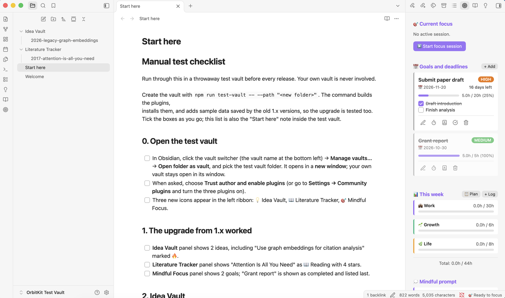

# Mindful Focus

Track what you're focusing on, log deep-work sessions, and plan around deadline-based goals.

## Features

- **Focus sessions.** A status-bar timer runs while you work. When the session
  ends, its time is recorded right away, and you can add an optional
  reflection afterwards. If a session stays open far longer than planned
  (overnight, say), you're welcomed back and asked how much of the time to
  record: as planned, all of it, another amount, or none. Nothing is recorded
  until you choose, and "Keep it running" leaves the session open.
- **Goals.** Each goal has a deadline, priority, estimated hours, milestones
  and logged progress. Goals are sorted by urgency, with completed goals last.
- **Labbooks.** Link a goal to a folder or note. You can open it in one
  click, add dated notes, and logged time and reflections are appended
  under `## Running Notes`.
- **Daily notes** with an hourly plan and a `## 📝 Log` section. New entries
  go at the top, and anything you wrote yourself is never overwritten.
- **Weekly plans** (`YYYY-Www-Plan.md`, ISO weeks starting on Monday) and
  **weekly time tracking** per life category.
- **Weekly project report.** Compares this week with last week: hours by
  project, goal progress, time by category, and insights.

The 🎯 target icon in the left ribbon (or the status-bar timer) opens the panel.

## A gentle tone

Mindful Focus is meant to support you, not judge you. It never says
"overdue" or "failed". A passed deadline is shown calmly ("Deadline passed 3
days ago"), goals that need a bit more time are marked *Needs attention*
with the option to adjust the plan, and a quieter week is described as
quieter, with a reminder that rest counts too. Reflections and next steps
are always optional.

## Commands

Start focus session · End focus session · Quick journal entry · Log progress ·
Open panel · Open today's note · Plan a future day · Plan a week ·
Log weekly time · Add goal · Review goals · Generate weekly report

There are no default hotkeys. Assign your own under **Settings → Hotkeys**.

## Settings

| Setting | Default | Used for |
| :-- | :-- | :-- |
| Daily notes | `Mindful Focus/Daily` | One note per day, `YYYY-MM-DD.md` |
| Weekly plans and reports | `Mindful Focus/Weekly` | `YYYY-Www-Plan.md` and `Weekly_Report_<Monday>.md` |
| Labbooks | `Mindful Focus/Labbooks` | Suggested parent folder for new labbooks |
| Default session length | `90` minutes | Pre-filled when starting a session |
| Show timer in the status bar | on | Status-bar timer |
| Prompts | 5 prompts | Journal and session prompts |

Folder paths must be inside the vault. Paths containing `..` or hidden folders are rejected.
Weekly categories, targets and display names (`lifeCategories`,
`weeklyTargets`, `categoryNames`) can be customised in `data.json`.

## Your data

Goals, settings, the time log and the running session are stored in this
plugin's `data.json` inside your vault. Nothing is sent anywhere. The time
log keeps about 400 days of entries. Deleting a goal asks for confirmation,
and it keeps that goal's notes and logged time.

## Install

**From Obsidian:** open **Settings → Community plugins → Browse**, search for
**Mindful Focus**, then click **Install** and **Enable**.

**By hand:** download `main.js`, `manifest.json` and `styles.css` from the
[latest release](https://github.com/nooshinjava/obsidian-mindful-focus/releases/latest) into
`<your vault>/.obsidian/plugins/mindful-focus/`, reload Obsidian and enable
**Mindful Focus** under **Settings → Community plugins**.

## Feedback

I'd love to hear how Mindful Focus works for you. Please open an
[issue](https://github.com/nooshinjava/obsidian-mindful-focus/issues) for bugs or ideas.

Mindful Focus is part of [OrbitKit](https://github.com/nooshinjava/OrbitKit),
where I develop it together with my other Obsidian plugins. This repository is
generated from there.

## Acknowledgements

I designed and built Mindful Focus. I used [Claude](https://www.anthropic.com/claude),
an AI assistant by Anthropic, to help with parts of the code, tests and
documentation.

## License

[MIT](LICENSE) © Nooshin Javaheripour
